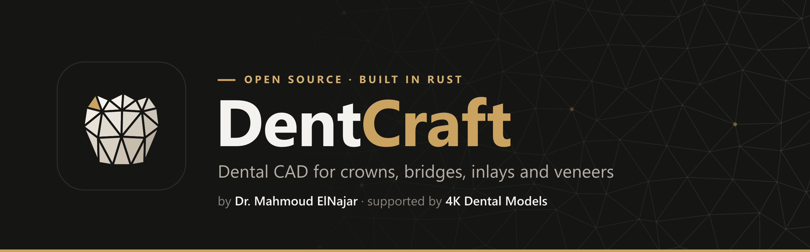
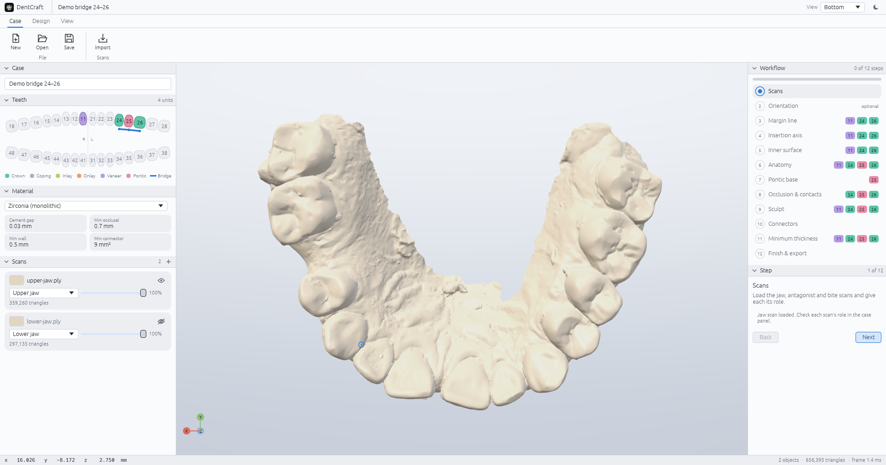
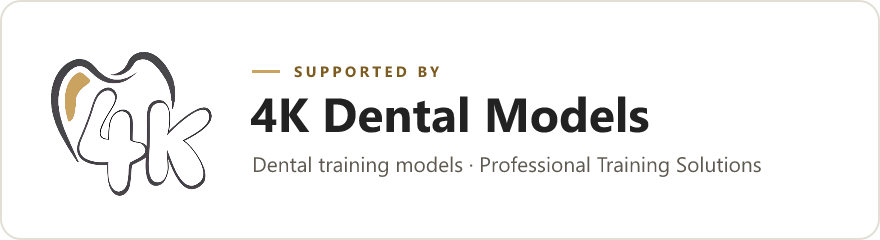

<p align="center">
  
</p>

<p align="center">
  <a href="https://github.com/elnajar1/DentCraft/actions/workflows/ci.yml"></a>
  <a href="#licence"></a>
  
  
  
</p>

<p align="center">
  <b>Design crowns, bridges, inlays, onlays and veneers on intraoral or model scans</b><br />
  with the guided, step-by-step workflow dental technicians already know: cleaner, faster and more precise.
</p>

## Screenshots

<p align="center">
  <picture>
    <source media="(prefers-color-scheme: dark)" srcset="docs/assets/screenshot-dark.png" />
    
  </picture>
</p>

<p align="center"><i>Anonymized intraoral scans. Design tools arrive in 0.2.</i></p>

<p align="center">
  <a href="#the-design-workflow">Workflow</a> ·
  <a href="#build-from-source">Build</a> ·
  <a href="ROADMAP.md">Roadmap</a> ·
  <a href="CONTRIBUTING.md">Contribute</a> ·
  <a href="#about">About</a> ·
  <a href="#بالعربي">العربية</a>
</p>

---

> [!IMPORTANT]
> **DentCraft is in early development.** It is not yet ready for production work and is not a
> cleared or certified medical device. Every design must be checked by a qualified dental
> professional before clinical use.

## Why DentCraft

Dental technicians spend their day in CAD software that is closed, tied to one operating system
and priced for large labs. DentCraft is the open alternative, built by people who work in
dentistry.

| | |
|---|---|
| 🦷 **The workflow you know** | One guided path per restoration: margin, insertion axis, cement gap, anatomy, contacts, thickness, export. Fewer clicks, clear feedback at every step. |
| 🎯 **Precise by design** | Geometry in double precision, every algorithm tested on degenerate scans, design limits taken from the material you choose. |
| 🛡️ **Stable** | Written in memory-safe Rust. No crashes from a malformed file, no lost work. |
| 💻 **Runs everywhere** | One codebase for Windows, macOS and Linux, plus a headless command line (browser build planned). |
| ⚡ **Automation built in** | Scan segmentation, margin detection and anatomy proposals that run on your own machine, with no per-design credits (planned). |
| 🌍 **Open and multilingual** | Free to use, study and improve under MIT OR Apache-2.0. Right-to-left languages, including Arabic, are on the roadmap. |

## The design workflow

A case lists the teeth to restore and the restoration on each. DentCraft builds the plan from that:
shared steps first, then the steps each restoration needs, tooth by tooth.

| # | Step | Crown | Coping | Inlay / Onlay | Veneer | Pontic |
|---|---|:-:|:-:|:-:|:-:|:-:|
| 1 | Scans | ● | ● | ● | ● | ● |
| 2 | Orientation *(optional)* | ● | ● | ● | ● | ● |
| 3 | Margin line | ● | ● | ● | ● | |
| 4 | Insertion axis | ● | ● | ● | ● | |
| 5 | Inner surface (cement gap) | ● | ● | ● | ● | |
| 6 | Anatomy | ● | | ● | ● | ● |
| 7 | Pontic base | | | | | ● |
| 8 | Occlusion & contacts *(optional)* | ● | | ● | | ● |
| 9 | Sculpt *(optional)* | ● | ● | ● | ● | ● |
| 10 | Connectors *(bridges)* | ● | ● | | | ● |
| 11 | Minimum thickness | ● | ● | ● | ● | ● |
| 12 | Finish & export | ● | ● | ● | ● | ● |

Material presets (zirconia, lithium disilicate, PMMA, wax) set the cement gap, margin seal,
minimum thickness and connector size. Teeth use FDI notation (ISO 3950).

## Build from source

Install a recent stable [Rust](https://rustup.rs) toolchain, then:

```sh
git clone https://github.com/elnajar1/DentCraft.git
cd DentCraft
cargo run --release -p dentcraft                  # desktop app
cargo run --release -p dentcraft-cli -- --help    # command line
cargo test --workspace
```

Linux needs the usual GUI development packages (`libxkbcommon-dev`, `libgtk-3-dev`).

## Code map

| Crate | Role |
|---|---|
| [`dentcraft-mesh`](crates/dentcraft-mesh) | Triangle mesh, topology, queries and repair |
| [`dentcraft-io`](crates/dentcraft-io) | STL, PLY and OBJ import and export |
| [`dentcraft-case`](crates/dentcraft-case) | Case model: teeth (FDI), restorations, bridges, scans, materials |
| [`dentcraft-workflow`](crates/dentcraft-workflow) | The design wizard: steps per restoration and session state |
| [`dentcraft-cli`](crates/dentcraft-cli) | Headless command line |
| [`dentcraft`](crates/dentcraft) | Desktop application (egui + wgpu) |

## Contributing

Dental technicians, dentists, students and developers are all welcome. Start with
[CONTRIBUTING.md](CONTRIBUTING.md); the clean-room rules in [AGENTS.md](AGENTS.md) apply to every
change. Technicians can help most by describing how they design a case today: open a
[workflow request](https://github.com/elnajar1/DentCraft/issues/new?template=workflow_request.yml).
Never share patient data.

If you use DentCraft in research or teaching, please cite it ([CITATION.cff](CITATION.cff)).

## About

DentCraft is created and maintained by **[Dr. Mahmoud ElNajar](https://github.com/elnajar1)**
and supported by **[4K Dental Models](https://4kdental.com)**, a maker of artificial teeth and
endodontic training models for dental students and residents.

<p align="center">
  <a href="https://4kdental.com">
    <picture>
      <source media="(prefers-color-scheme: dark)" srcset="docs/assets/sponsor-4k-dark.png" />
      
    </picture>
  </a>
</p>

## Licence

DentCraft is free and open source, licensed under either of [MIT](LICENSE-MIT) or
[Apache-2.0](LICENSE-APACHE) at your option. See [NOTICE](NOTICE).

DentCraft is independent and is not affiliated with, sponsored by or endorsed by any dental CAD
vendor. Product names appear only to describe compatibility.

---

<div dir="rtl">

## بالعربي

**DentCraft** برنامج مفتوح المصدر لتصميم التركيبات السنية (Dental CAD)، مكتوب بلغة Rust. بيمشي
على نفس خطوات العمل اللي فنيين المعامل متعودين عليها، بس بشكل أنضف وأسهل وأدق. بيشتغل على Windows
وmacOS وLinux، ومجاني للجميع.

صمّم البرنامج ويطوّره **د. محمود النجار**، بدعم من **[4K Dental Models](https://4kdental.com)**.

البرنامج لسه في مرحلة التطوير المبكرة، ومش جهاز طبي معتمد. أي تصميم لازم يراجعه متخصص قبل
استخدامه إكلينيكيًا. مساهماتك وملاحظاتك كفني أسنان أو طبيب مرحّب بيها جدًا.

</div>
