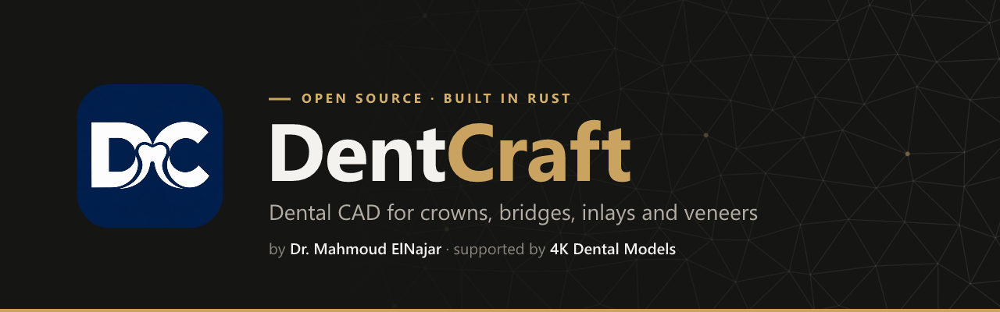
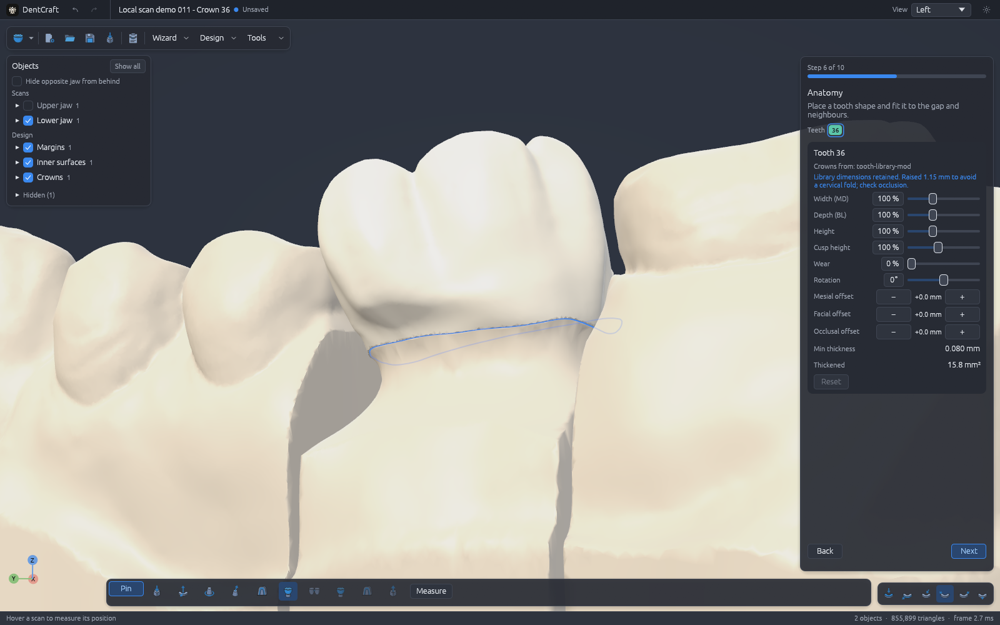
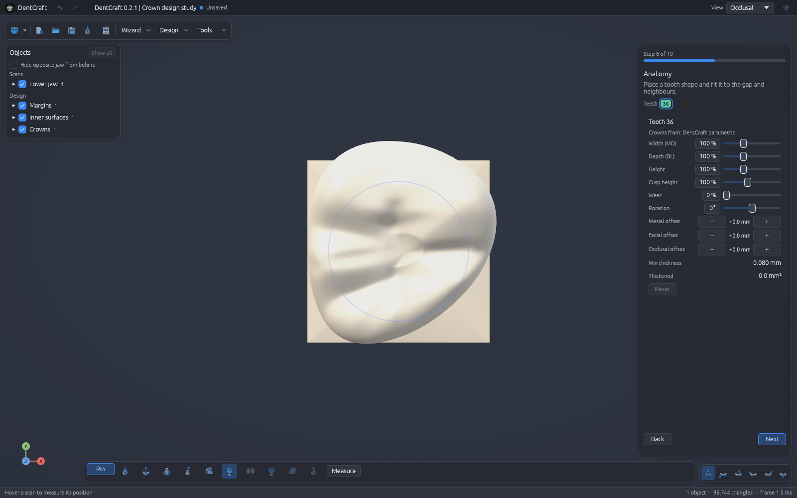
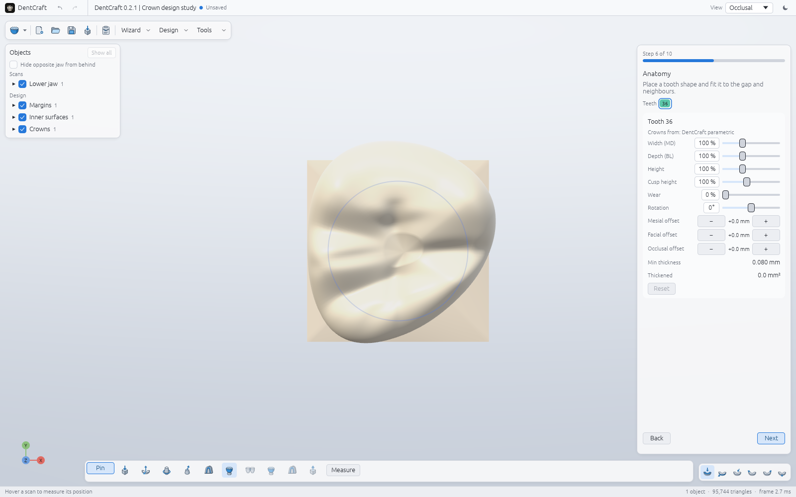
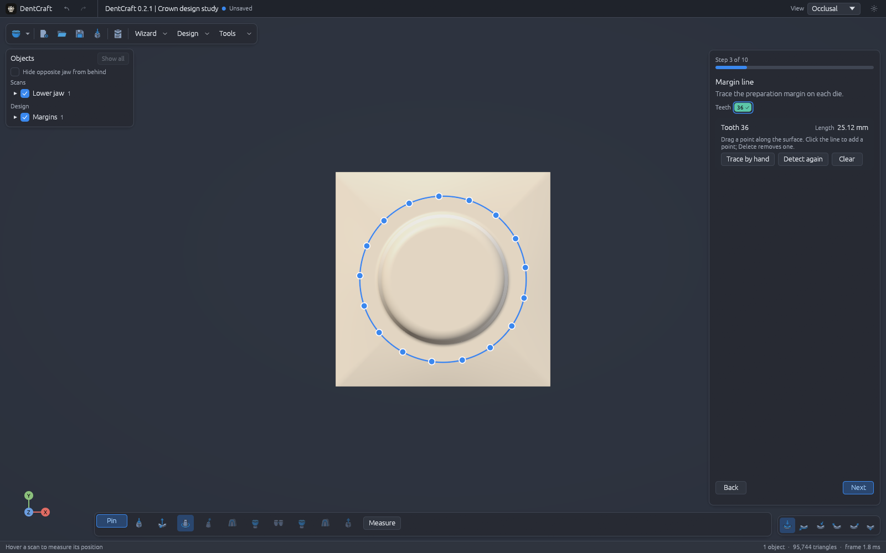
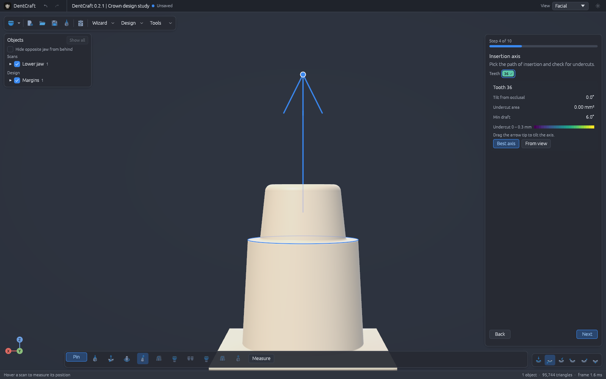
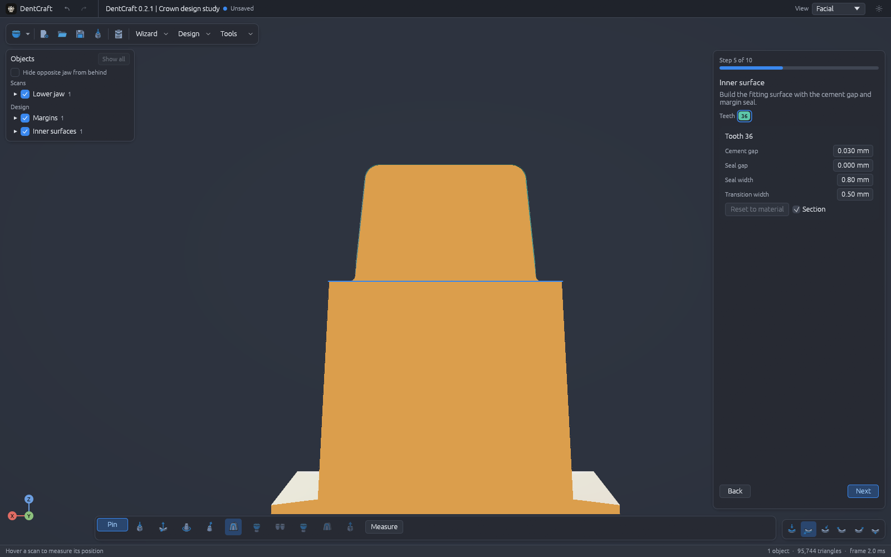
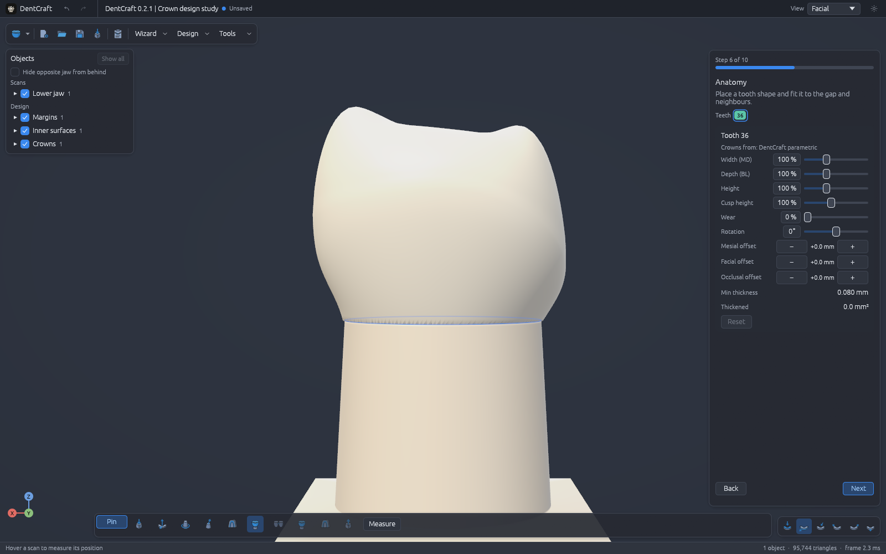
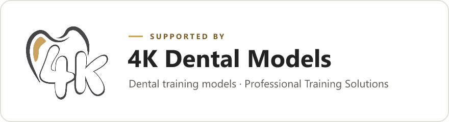

<p align="center">
  
</p>

<p align="center">
  <a href="https://github.com/elnajar1/DentCraft/actions/workflows/ci.yml"></a>
  <a href="#licence"></a>
  
  
  
  <a href="https://github.com/elnajar1/DentCraft/releases/tag/v0.2.1"></a>
</p>

<p align="center">
  <b>Your anatomy. Your workflow. An open foundation.</b><br />
  Open-source dental CAD with a focused crown-design workspace, your own tooth libraries,
  and a guided path from preparation to STL.
</p>

<p align="center">
  <a href="https://github.com/elnajar1/DentCraft/releases/tag/v0.2.1"><b>Download 0.2.1 for Windows</b></a> ·
  <a href="CHANGELOG.md">What's new</a> · <a href="ROADMAP.md">Roadmap</a>
</p>

## Built around the crown

**Keep the anatomy you chose.** Imported library teeth retain their millimetre scale instead of
being stretched to textbook proportions. DentCraft seats the tooth, adapts the cervical region,
and reports extra lift or a fallback so you can review the result.

**Give the design room to breathe.** A floating wizard, compact toolbar and Objects panel put
the model at the centre. Pin the Expert strip, select design parts, and apply settings across
teeth with one undoable operation.

**See what the geometry is doing.** Follow the margin, inspect the insertion axis, section the
inner surface and review material thickness. Geometry uses double precision; automated tests
include tilted, noisy preparations and true 3D distances inside triangles.

## Screenshots

### Crown fitting on a scanned demo case

<p align="center">
  
</p>

A scanned demo case rendered in DentCraft with the owner's tooth library. The library scale is
retained, with local cervical adaptation. The interface reports the additional **1.15 mm lift**
needed for this fit; occlusion still requires review. This is a development example, not a
clinically approved restoration. Published with owner-confirmed permission for the displayed
case and library; [image provenance](docs/assets/README.md).

### The workspace on generated geometry

<p align="center">
  
</p>

<p align="center"><i>The actual 0.2.1 workspace. This synthetic gallery uses a procedural preparation
generated by DentCraft, with its built-in parametric anatomy. No patient data or external tooth library is shown.</i></p>

<details>
<summary>See the light workspace</summary>

</details>

### Designing a crown, step by step

| Margin line | Insertion axis and undercuts |
|---|---|
|  |  |
| **Inner surface (section view)** | **Built-in parametric crown anatomy** |
|  |  |

<p align="center"><i>A synthetic preparation made by DentCraft's test generator. The crown is
exported as a closed STL: 0.08 mm at the margin, the material's minimum thickness everywhere else.</i></p>

<p align="center">
  <a href="#the-design-workflow">Workflow</a> ·
  <a href="#build-from-source">Build</a> ·
  <a href="ROADMAP.md">Roadmap</a> ·
  <a href="CONTRIBUTING.md">Contribute</a> ·
  <a href="#about">About</a> ·
  <a href="#بالعربي">العربية</a>
</p>

---

> [!IMPORTANT]
> **DentCraft is in early development.** It is not yet ready for production work and is not a
> cleared or certified medical device. Every design must be checked by a qualified dental
> professional before clinical use.

## Why DentCraft

From the first margin point to the exported crown, every design decision deserves a clear place
in the workspace. DentCraft brings that process into an open, inspectable tool built by people
who work in dentistry—and shaped by the technicians, clinicians and developers who use it.

| | |
|---|---|
| 🦷 **The workflow you know** | A guided crown-design path: margin, insertion axis, cement gap, anatomy, contacts, thickness and export. Focused tools with visible feedback. |
| 🎯 **Precision you can inspect** | Double-precision geometry, regression tests for difficult inputs, and design limits taken from the material you choose. |
| 🛡️ **Recovery built in** | Memory-safe Rust, guarded background jobs, autosave and recovery prompts help protect the workflow. |
| 💻 **Runs everywhere** | One codebase for Windows, macOS and Linux, plus a headless command line (browser build planned). |
| ⚡ **Local design tools** | Margin detection, insertion-axis estimation and crown fitting run on your own machine. Broader automation is on the roadmap. |
| 🌍 **Open and multilingual** | Free to use, study and improve under MIT OR Apache-2.0. Right-to-left languages, including Arabic, are on the roadmap. |

## The design workflow

A case lists the teeth to restore and the restoration on each. DentCraft builds the plan from that:
shared steps first, then the steps each restoration needs, tooth by tooth.

**Single crowns are the supported end-to-end workflow in 0.2.1.** The table below describes the
workflow model; it does not mean every restoration type is implemented. Bridges, pontics,
copings, inlays, onlays and veneers remain on the [roadmap](ROADMAP.md).

| # | Step | Crown | Coping | Inlay / Onlay | Veneer | Pontic |
|---|---|:-:|:-:|:-:|:-:|:-:|
| 1 | Scans | ● | ● | ● | ● | ● |
| 2 | Orientation *(optional)* | ● | ● | ● | ● | ● |
| 3 | Margin line | ● | ● | ● | ● | |
| 4 | Insertion axis | ● | ● | ● | ● | |
| 5 | Inner surface (cement gap) | ● | ● | ● | ● | |
| 6 | Anatomy | ● | | ● | ● | ● |
| 7 | Pontic base | | | | | ● |
| 8 | Occlusion & contacts *(optional)* | ● | | ● | | ● |
| 9 | Sculpt *(optional)* | ● | ● | ● | ● | ● |
| 10 | Connectors *(bridges)* | ● | ● | | | ● |
| 11 | Minimum thickness | ● | ● | ● | ● | ● |
| 12 | Finish & export | ● | ● | ● | ● | ● |

Material presets (zirconia, lithium disilicate, PMMA, wax) set the cement gap, margin seal,
minimum thickness and connector size. Teeth use FDI notation (ISO 3950).

## Download

**[DentCraft 0.2.1 for Windows](https://github.com/elnajar1/DentCraft/releases/tag/v0.2.1)**: a single
`.exe` with nothing to install. The prerelease includes a separate command-line executable and
SHA-256 checksums. It designs a single crown from margin to STL; see the
[changelog](CHANGELOG.md) for what's in it and its known limitations. macOS and Linux users build
from source below.

## Build from source

Install a recent stable [Rust](https://rustup.rs) toolchain, then:

```sh
git clone https://github.com/elnajar1/DentCraft.git
cd DentCraft
cargo run --release -p dentcraft                  # desktop app
cargo run --release -p dentcraft-cli -- --help    # command line
cargo test --workspace
```

Linux needs the usual GUI development packages (`libxkbcommon-dev`, `libgtk-3-dev`).

## Code map

| Crate | Role |
|---|---|
| [`dentcraft-mesh`](crates/dentcraft-mesh) | Triangle mesh, topology, queries and repair |
| [`dentcraft-io`](crates/dentcraft-io) | STL, PLY and OBJ import and export |
| [`dentcraft-case`](crates/dentcraft-case) | Case model: teeth (FDI), restorations, bridges, scans, materials |
| [`dentcraft-workflow`](crates/dentcraft-workflow) | The design wizard: steps per restoration and session state |
| [`dentcraft-cli`](crates/dentcraft-cli) | Headless command line |
| [`dentcraft`](crates/dentcraft) | Desktop application (egui + wgpu) |

## Contributing

Dental technicians, dentists, students and developers are all welcome. Start with
[CONTRIBUTING.md](CONTRIBUTING.md); the clean-room rules in [AGENTS.md](AGENTS.md) apply to every
change. Technicians can help most by describing how they design a case today: open a
[workflow request](https://github.com/elnajar1/DentCraft/issues/new?template=workflow_request.yml).
Never share patient data.

If you use DentCraft in research or teaching, please cite it ([CITATION.cff](CITATION.cff)).

## About

DentCraft is created and maintained by **[Dr. Mahmoud ElNajar](https://github.com/elnajar1)**
and supported by **[4K Dental Models](https://4kdental.com)**, a maker of artificial teeth and
endodontic training models for dental students and residents.

<p align="center">
  <a href="https://4kdental.com">
    <picture>
      <source media="(prefers-color-scheme: dark)" srcset="docs/assets/sponsor-4k-dark.png" />
      
    </picture>
  </a>
</p>

## Licence

DentCraft is free and open source, licensed under either of [MIT](LICENSE-MIT) or
[Apache-2.0](LICENSE-APACHE) at your option. See [NOTICE](NOTICE).

DentCraft is independent and is not affiliated with, sponsored by or endorsed by any dental CAD
vendor. Product names appear only to describe compatibility.

---

<div dir="rtl">

## بالعربي

**تشريحك. أسلوب شغلك. وأساس مفتوح للتطوير.**

**DentCraft** برنامج مفتوح المصدر لتصميم التركيبات السنية (Dental CAD)، مكتوب بلغة Rust.
الإصدار **0.2.1** بيركّز على تصميم الكراون من التحضير لملف STL: واجهة أوسع للموديل، مكتبة أسنانك
بمقياسها الأصلي، وتعديل موضعي عند العنق مع توضيح أي رفع إضافي أو استخدام للشكل البديل.
تقدر تختار أجزاء التصميم وتطبّق الإعدادات على أكتر من سن مع التراجع عن العملية بخطوة واحدة.

نسخة Windows جاهزة للتحميل، وmacOS وLinux متاحين بالبناء من المصدر. البرنامج مجاني للجميع؛
الجسور وباقي أنواع التركيبات لسه ضمن خطة التطوير.

صمّم البرنامج ويطوّره **د. محمود النجار**، بدعم من **[4K Dental Models](https://4kdental.com)**.

البرنامج لسه في مرحلة التطوير المبكرة، ومش جهاز طبي معتمد. أي تصميم لازم يراجعه متخصص قبل
استخدامه إكلينيكيًا. مساهماتك وملاحظاتك كفني أسنان أو طبيب مرحّب بيها جدًا.

</div>
